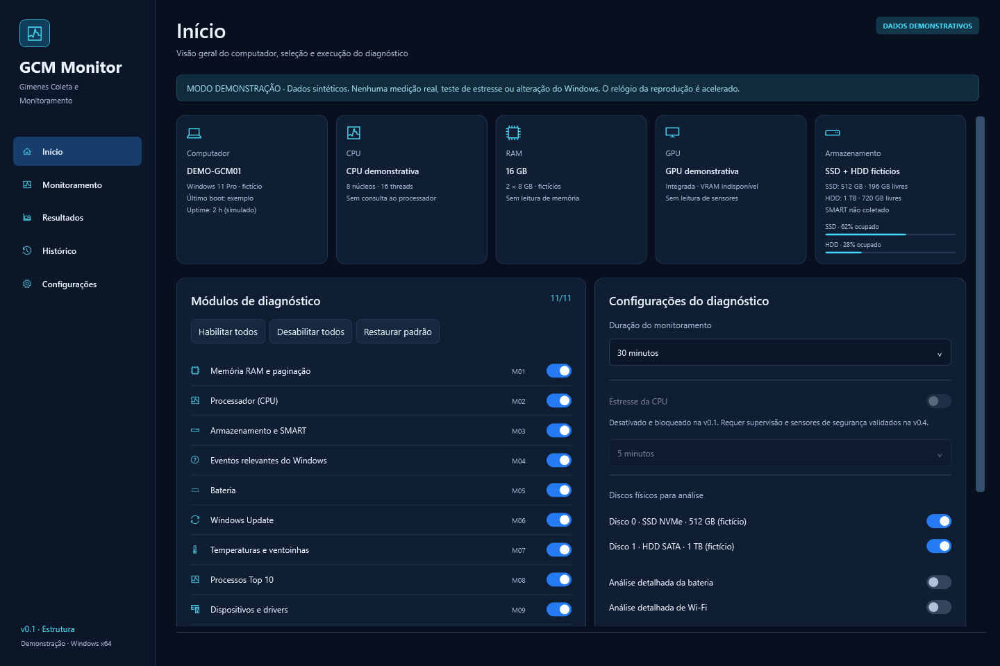

# GCM Monitor — Gimenes Coleta e Monitoramento

Aplicativo Windows de diagnóstico e monitoramento para técnicos de informática.
**v0.1.0: estrutura executável e demonstração sintética. Não usar para diagnosticar clientes.**

A [Especificação Mestre v1.0](docs/ESPECIFICACAO_MESTRE_GCM_MONITOR_v1.0.md) é a fonte de escopo.
Esta entrega implementa somente a primeira etapa da seção 14. Não executa coleta real,
estresse, ping, atualizações, reparos, instalação de drivers ou alterações no Windows.

## Requisitos de desenvolvimento

- Windows x64 com ambiente gráfico; plataforma principal planejada: Windows 11.
- SDK **.NET 10.0.403 x64**, fixado em `global.json`. O SDK .NET 8 não compila esta solução.
- Git e acesso ao NuGet no primeiro restore.
- PowerShell 7 recomendado. Visual Studio com suporte a .NET 10/WPF é opcional.

O SDK pode ser instalado pelo [distribuidor oficial da Microsoft](https://dotnet.microsoft.com/en-us/download/dotnet/10.0).
Um SDK isolado em `.tools/dotnet/` também é reconhecido pelos scripts, sem alterar o PATH global.
`.tools/` contém apenas ferramentas e cache locais e não integra a distribuição.

## Compilar, testar e abrir

Na raiz do repositório:

```powershell
.\scripts\dev.ps1 Restore
.\scripts\dev.ps1 Build
.\scripts\dev.ps1 Test
.\scripts\dev.ps1 Run
```

Os scripts isolam os caches em `.tools/`, usam restore travado e falham quando o comando retorna erro.
Para compilar/testar Release, acrescente `-Configuration Release` a Build e Test.
Também é possível usar `dotnet restore GcmMonitor.sln --locked-mode`,
`dotnet build GcmMonitor.sln --no-restore` e `dotnet test GcmMonitor.sln --no-build`.
Ao abrir diretamente o executável de desenvolvimento, o runtime .NET Desktop 10 precisa estar
instalado ou `DOTNET_ROOT` precisa apontar ao SDK isolado. O script Run já configura isso.

O build copia o motor e suas dependências para a subpasta `engine/` do aplicativo.
Não copie apenas o `.exe`: o conjunto de saída é necessário. Isso é execução de desenvolvimento,
**não uma edição portátil nem um instalador de distribuição**.

## Revisar a demonstração

1. Em **Início**, escolha entre os 11 módulos e uma das quatro durações aprovadas.
   Seleção vazia e armazenamento sem disco selecionado são rejeitados.
2. Clique em **Iniciar diagnóstico**. A ação reproduz dados fictícios durante cerca de 10 segundos,
   com **relógio simulado acelerado**; não executa um diagnóstico real de 5 minutos a 4 horas.
   Sessões somente com consultas pontuais terminam assim que a reprodução acaba.
3. Navegue sem interromper a sessão. O Início informa a sessão ativa e impede uma segunda execução.
   **Cancelar diagnóstico** preserva o estado parcial demonstrativo.
4. Em **Resultados**, expanda módulos e salve observações associadas à sessão fictícia.
   Indisponibilidade de sensores não é representada por zero nem por um estado saudável.
5. Em **Histórico**, filtre por computador, data `dd/MM/aaaa` e estado; abra resultados e exclua
   sessões finalizadas com confirmação. Se o histórico estiver vazio, **Carregar exemplos fictícios**
   cria quatro cenários: concluído, cancelado, interrompido e erro.
6. Em **Configurações**, confira os controles fixos e as preferências ilustrativas.
   Avisos informativos e pasta de PDF são editáveis somente durante esta execução; ainda não são persistidos.

Tema exclusivamente escuro, navegação lateral com exatamente cinco telas e PT-BR fixo.
Estresse está separado, desligado e bloqueado inclusive após **Habilitar todos**.
Nenhum código de geração de carga existe nesta versão. Não há pausa nem tela Diagnóstico.



## Estrutura

| Projeto | Responsabilidade nesta etapa |
|---|---|
| `GcmMonitor.App` | WPF/XAML, tema, composição por DI, diálogos e cliente do motor |
| `GcmMonitor.Presentation` | MVVM testável: navegação, seleção, estados e comandos |
| `GcmMonitor.Core` | Entidades, estados, catálogo, validação e contratos versionados |
| `GcmMonitor.Collector` | Fontes determinísticas e cenários **somente sintéticos** |
| `GcmMonitor.Engine` | Processo de sessão demonstrativa; validação, reprodução e persistência |
| `GcmMonitor.Persistence` | Fundação SQLite: snapshots, transições, notas e exclusão protegida |
| `GcmMonitor.StressSupervisor` | Executável reservado que recusa execução; não gera carga |
| `GcmMonitor.UnitTests` | Contratos e regras da apresentação |
| `GcmMonitor.IntegrationTests` | SQLite real, processos reais com dados sintéticos e renderização WPF |

O auxiliar privilegiado é opcional na especificação e não é necessário nesta etapa.
Veja [arquitetura e limites](docs/arquitetura/V0.1.md),
[dependências e licenças](docs/DEPENDENCIAS.md),
[evidências e limitações](docs/testes/RELATORIO_V0.1.md) e
[distribuição futura](installer/InnoSetup/README.md).

## Dados e privacidade

Banco exclusivamente demonstrativo: `%LOCALAPPDATA%\GCM Monitor\Data\demo-v0.1.db`.
Ele é separado do futuro `gcm-monitor.db`, para não misturar fixtures com diagnósticos reais.
Transações curtas, WAL, sincronização FULL, snapshots e diário de transições; notas separadas
não são sobrescritas pela atualização do motor. Gráficos limitam a janela a 32 pontos por série.
O histórico consulta até 100 sessões por vez; paginação e retenção automática ficam para as etapas seguintes.

Bancos, auxiliares WAL/SHM, PDFs, logs, dumps, builds e caches são ignorados pelo Git.
Não inclua dados de clientes neste repositório público. Limpar histórico remove apenas registros
terminais do banco demonstrativo; não percorre pastas externas nem apaga relatórios exportados.

## Próximas etapas

- **v0.2:** fontes reais de CPU/RAM/processos/discos, persistência normalizada e cancelamento passivo.
- **v0.3:** diagnósticos avançados e prova de capacidade por hardware/API.
- **v0.4:** supervisão isolada e validação em laboratório; estresse continuará bloqueado até aprovação dos P0.
- **v1.0:** PDF final, configurações definitivas, histórico completo, Inno Setup e matriz de liberação.

**Não validado em hardware real.** A aprovação de testes desta estrutura não aprova sensores,
precisão de medições, compatibilidade ampla, segurança de estresse ou distribuição em clientes.
