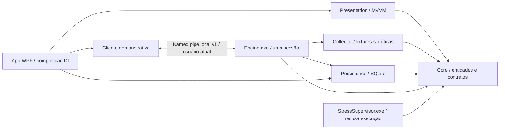

# Arquitetura da v0.1

Escopo: seção 14 da Especificação Mestre v1.0. Nenhum coletor real está integrado.

## Responsabilidades e ciclo de vida

- WPF contém apenas renderização, diálogos, composição e adaptação do processo local.
  `ShellViewModel` centraliza o estado de navegação; as cinco views observam a mesma instância,
  sem recriar uma sessão ao navegar. O code-behind trata somente ciclo de janela e inicialização visual.
- `CommunityToolkit.Mvvm` fornece notificações e comandos; DI usa `Microsoft.Extensions.DependencyInjection`.
- O controlador inicia um motor novo por sessão e aguarda snapshots. A UI não calcula o estado
  autoritativo da reprodução: exibe os estados recebidos; falha de canal é sinalizada como interrupção.
- O motor só conhece `DemoCollector`. Reproduz até 20 passos em aproximadamente 10 segundos,
  independentemente da duração ilustrada. Duração, timestamps das amostras e progresso são simulados;
  os timestamps das transições registram o relógio efetivo da aplicação. Isso não serve para avaliar precisão.
- Consultas somente pontuais não aguardam a duração de monitoramento. Cancelamento é idempotente,
  preserva módulos parciais/cancelados e persiste um estado terminal.
- Fechamento normal solicita cancelamento, aguarda até três segundos e, se necessário,
  encerra apenas a árvore do processo criado pelo próprio cliente. O motor tem limite de vida de 45 s.
  Não há serviço, tarefa agendada ou supervisor de carga residente.
- O mutex impede duas UIs demonstrativas na mesma sessão do Windows. A recuperação de snapshots
  sem estado terminal marca interrupção; nunca reinicia motor nem estresse.

## Contratos e segurança

`IDiagnosticCollector`, `IDiagnosticEngineClient`, `ISessionRepository` e `IStressSupervisor`
separam domínio de fontes, processos e armazenamento. Estados de sessão e módulo seguem o catálogo aprovado.
Medições têm módulo, componente, unidade, horário, fonte, qualidade e marcador `IsDemo`.
Valores indisponíveis são nulos; qualidade válida exige número finito. O armazenamento desta etapa
rejeita sessões e amostras não demonstrativas.

IPC: named pipe de nome aleatório criado pela UI, `CurrentUserOnly` nos dois lados,
protocolo 1, identificação por GUID, sequência crescente e mensagens JSON com tamanho prefixado
limitado a 256 KiB **antes da alocação do conteúdo**. Há validação de versão, identidade,
opções e snapshots; o único comando aceito é `cancel`. Não há execução de comandos do sistema,
operações privilegiadas, carga ou acesso de rede para diagnóstico.

A restrição ao usuário atual autentica a identidade Windows do canal, mas não atesta a integridade
do executável contra outro processo malicioso da mesma conta. ACLs, autenticação reforçada,
credenciais de processo, Job Objects, heartbeat e políticas de falhas precisam de prova de conceito
antes da coleta/estresse reais. Não são declarados implementados ou validados nesta entrega.

## Persistência inicial

SQLite separado para demonstração (`Data/demo-v0.1.db`):

- `Sessions`: snapshot serializado, chave, início UTC, estado terminal e notas.
- `SessionTransitions`: sequência de transições com horário e motivo, dentro da transação do snapshot.
- WAL, `synchronous=FULL`, `foreign_keys=ON`, timeout limitado e autocheckpoint de 1.000 páginas.
- Notas gravadas em coluna própria; atualização de snapshot não sobrescreve edição do técnico.
- DELETE usa chave parametrizada e `Terminal=1`; limpeza total também mantém sessões ativas.
- Consultas limitadas a 100 linhas na UI. Gráficos usam até 32 pontos por série.

A normalização completa de amostras, achados, processos, exportações e preferências,
recuperação após queda real e orçamento de retenção/recursos pertencem às etapas seguintes.
SQLite usa operações síncronas internamente; transações de coleta ficam no processo do motor.
As operações pequenas de histórico/notas desta demonstração não equivalem à validação de latência em produção.

## Decisões e pendências sem alteração do escopo

1. Banco demonstrativo separado para não contaminar o futuro banco de diagnósticos reais.
2. Não integrar sensores, PDFsharp/MigraDoc, ScottPlot, WMI ou drivers nesta etapa: aguardam as provas de conceito previstas.
3. Gráfico demonstrativo WPF simples, com eixos e unidades; não constitui escolha final de biblioteca de gráficos.
4. A especificação não define o subconjunto recomendado de módulos. O padrão **demonstrativo** seleciona os 11;
   estresse nunca é incluído. Confirmar a recomendação por capacidades na v0.2/v0.3, sem criar módulo adicional.
5. Tema, idioma e cadência não são editáveis. Preferências demonstrativas não são anunciadas como persistentes.
6. Retenção permanece manual nesta fundação; opções definitivas e paginação serão implementadas na etapa aprovada.
7. Auxiliar privilegiado não criado: nenhum recurso desta etapa necessita de elevação.
8. Estresse é recusado também no contrato e no executável reservado, não apenas no controle visual.

Nenhuma dessas decisões autoriza antecipar funcionalidades ou reduzir requisitos da Especificação Mestre.
